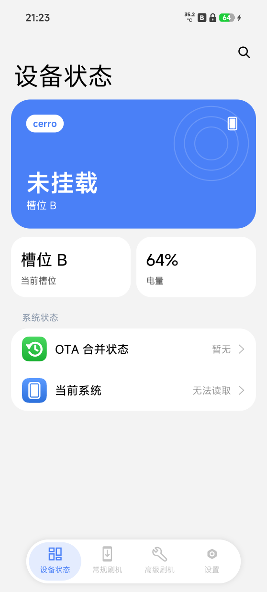
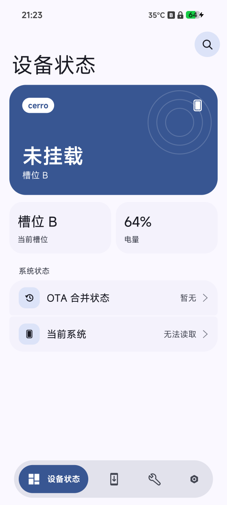
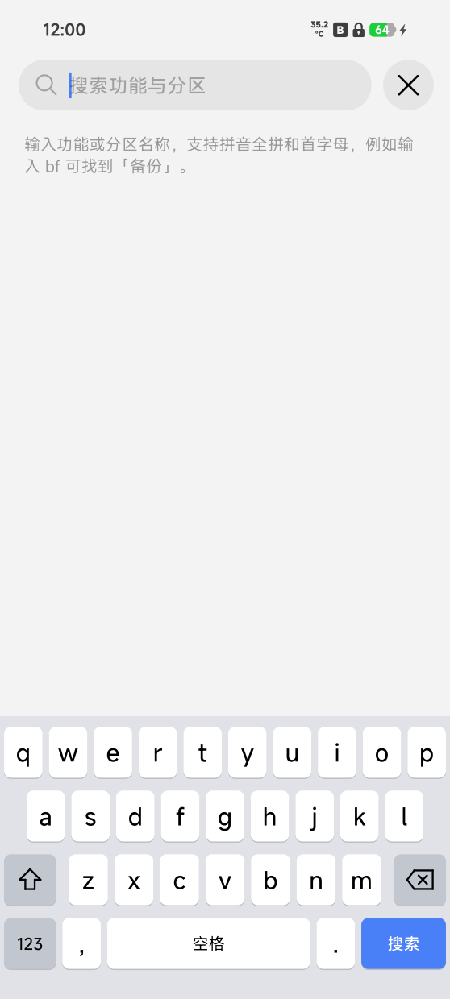
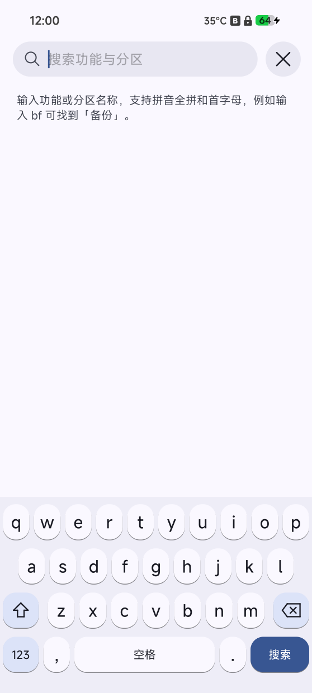

# AuroraLynx Recovery

A touch recovery for AuroraAOSP, built on [Skyward](https://github.com/kirklin/skyward), with consistent interaction and replayable device integration.

[简体中文](README.zh-CN.md) · [Changelog](CHANGELOG.md) · [Provenance](docs/UPSTREAM.md)

## Preview

These are AuroraLynx host-rendered previews, not device photographs.

### MIUIX

### MD3E

### Keyboard

## AuroraLynx features

- **Unified flashing:** select an OTA, script ZIP or partition image from one entry. Image targets can be changed manually; ZIP files cannot be written as partition images.
- **Visible installation:** scrollable logs below progress for OTA, script, image and module installation, with volume/power key and getevent compatibility paths for scripts.
- **Two visual styles:** MIUIX colorful icons, capsule sliders and back waves; MD3E grouped cards and predictive back. Shared controls manage animation state while keeping each style’s geometry and palette.
- **Floating navigation and keyboard:** navigation stays outside page transitions. Typing animates the dock away and brings in a keyboard aligned with the screen bottom; dismissal reverses the transition.
- **Saved connections:** create, save, load and delete multiple AI providers, VNC connections and ZeroTier networks. Loading does not connect automatically.
- **Remote tools:** VNC client, OpenAI-compatible assistant and ZeroTier entry points. Availability depends on the network, server and device integration; VNC needs an existing server.
- **Device integration:** AuroraAOSP product configuration and replayable patches. Mobile networking remains experimental; universal zero-configuration support is not claimed.

## Validation status

An earlier Cerro recoveryimage completed its build and AVB checks. The latest saved profiles, field fixes and animation settling changes previously passed 401 UI host tests. This publication does not rebuild recovery; these changes await device acceptance testing. Screenshots do not establish device support or measured frame rates. Script key compatibility does not cover every third-party keycheck implementation.

Connection credentials are saved in local settings and **are not encrypted**. Do not commit personal settings.

## Build and attribution

This is an independent recovery source checkout. Flashable device images require the product integration and fixed-baseline patch stack in [AuroraAOSP](https://github.com/ycrrongos/PlasmaAOSP). A host preview executable is not a flashable image.

See [provenance and host commands](docs/UPSTREAM.md), the archived [upstream English README](docs/UPSTREAM-README.md) and [Chinese README](docs/UPSTREAM-README.zh-CN.md). Upstream licenses and copyright notices are retained.

AuroraLynx maintenance and contribution credit: **ycrrongos**. Upstream attribution remains intact.
