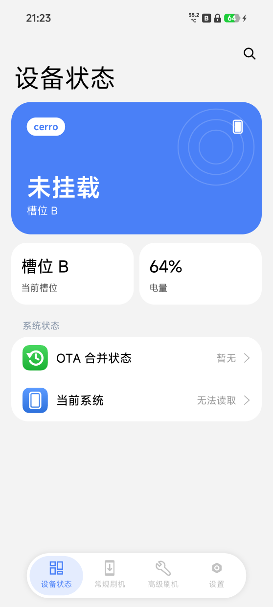
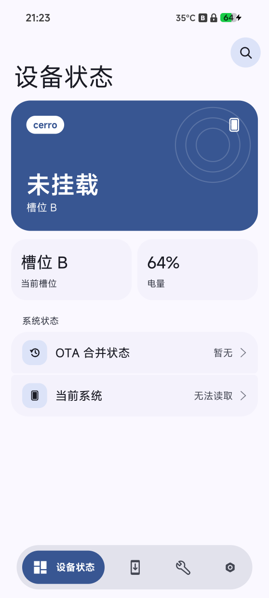
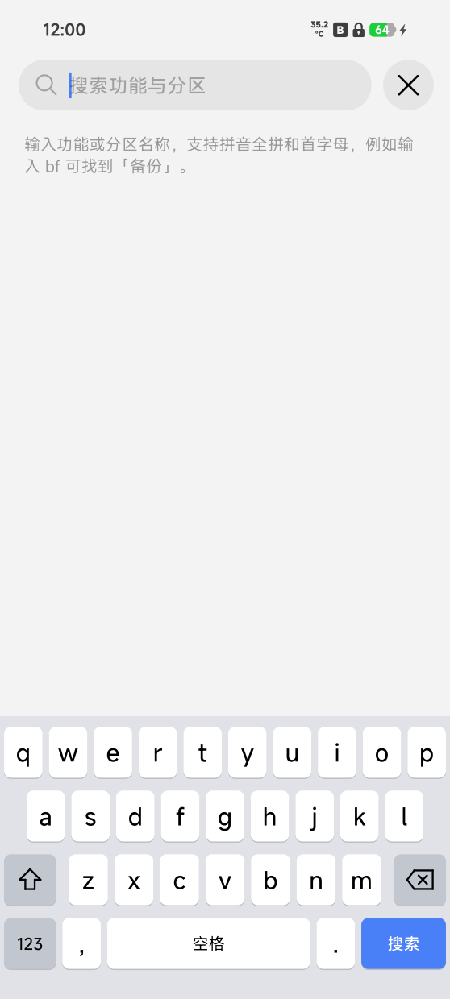
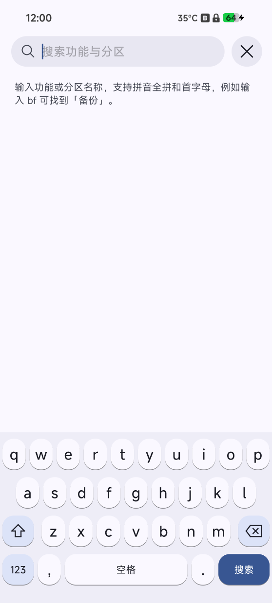

# AuroraLynx Recovery

面向 AuroraAOSP 的触屏 Recovery，基于 [Skyward](https://github.com/kirklin/skyward) 开发，以一致的交互和可重放的设备集成为目标。

[English](README.md) · [更改日志](CHANGELOG.md) · [上游来源](docs/UPSTREAM.md)

## 界面预览

以下为 AuroraLynx 自有主机渲染预览，非真机照片。截图展示 MIUIX 与 MD3E 两套独立风格。

### MIUIX

### MD3E

### 输入与键盘

## AuroraLynx 的改动

- **统一刷入**：一个文件选择入口，识别 OTA、脚本 ZIP 和分区镜像；镜像可手动更改目标分区，ZIP 不允许作为分区镜像写入。
- **可查看的安装过程**：进度下方提供可滚动日志，覆盖 OTA、脚本、镜像与模块安装；提供音量键、电源键及 getevent 的脚本兼容路径。
- **两套界面**：MIUIX 的彩色图标、胶囊滑块与返回波纹，MD3E 的分组卡片与预测返回；共用控件统一管理状态动画，保留各自几何和配色。
- **悬浮底栏与贴底键盘**：底栏独立于页面转场；输入时底栏移出淡出，键盘贴底过渡，关闭时反向恢复。
- **连接配置列表**：AI 助手供应商、VNC 连接、ZeroTier 网络均可新建、保存、加载和删除多个配置，加载不自动连接。
- **远程工具**：集成 VNC 客户端、兼容 OpenAI 接口的助手和 ZeroTier 入口。可用性取决于网络、服务端及设备集成；VNC 需要已有服务端。
- **设备集成**：通过 AuroraAOSP 产品配置和补丁栈接入，移动网络仍为实验能力，不能保证任意机型免适配。

## 验证状态

较早版本已完成 Cerro recoveryimage 构建及 AVB 检查。最新配置列表、输入框修复和动画收敛修复此前通过 401 项 UI 主机测试，本次发布未重新编译 recovery，尚待真机验收。预览图不代表这些最新改动已在手机运行，未测量真机帧率。脚本按键兼容不保证覆盖所有第三方 keycheck 实现。

连接密钥和密码随本地设置保存，**并非加密存储**。请勿把个人设置文件提交到仓库。

## 构建与来源

此仓库为独立 Recovery 源码检出。设备镜像需要配合 [AuroraAOSP](https://github.com/ycrrongos/PlasmaAOSP) 的产品配置和固定上游补丁栈构建；不能将主机预览程序直接当作可刷写镜像。

上游基线、主机预览命令和许可证说明见 [来源文档](docs/UPSTREAM.md)。保留 [上游英文说明](docs/UPSTREAM-README.md)、[上游中文说明](docs/UPSTREAM-README.zh-CN.md) 以及源码中的原始版权声明。

AuroraLynx 维护与贡献署名：**ycrrongos**。上游作者的版权与来源保持原样。
